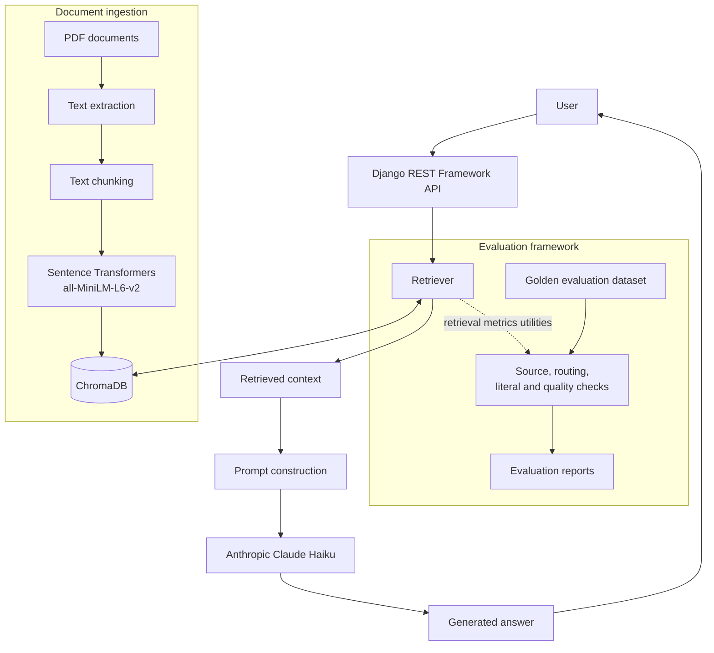

# VYRA — Document-Grounded Conversational AI

VYRA is a retrieval-augmented generation (RAG) application designed to answer questions using an indexed document collection. It combines a Django REST Framework backend, semantic retrieval, a ChromaDB vector store, Sentence Transformers embeddings, and Anthropic Claude Haiku for response generation.

> **Evaluation note:** The metrics below are from a recorded evaluation run dated 12 October 2026. They are historical, heuristic evaluation results—not a claim of independently verified answer accuracy or a current production benchmark.

## What VYRA does

- Ingests PDF documents and extracts their text.
- Splits extracted text into smaller chunks for retrieval.
- Creates vector embeddings using `all-MiniLM-L6-v2`.
- Stores and retrieves document vectors using ChromaDB.
- Retrieves relevant context for a user's question.
- Constructs a prompt using the retrieved context and generates an answer with Claude Haiku.
- Includes an evaluation framework for retrieval and answer-quality diagnostics.

## Architecture



## Technology

| Layer | Technology |
|---|---|
| Backend API | Django, Django REST Framework |
| LLM | Anthropic Claude Haiku |
| Embeddings | Sentence Transformers — `all-MiniLM-L6-v2` |
| Vector database | ChromaDB |
| Retrieval | Semantic vector retrieval |
| Evaluation | Python evaluation utilities and golden datasets |

## RAG workflow

1. **Ingestion:** PDF files are loaded and their text is extracted.
2. **Chunking:** Text is divided into smaller passages for retrieval.
3. **Embedding:** Each passage is converted into a vector using `all-MiniLM-L6-v2`.
4. **Indexing:** Vectors and associated document metadata are stored in ChromaDB.
5. **Retrieval:** A user's question is embedded and used to retrieve candidate passages.
6. **Generation:** Retrieved context is incorporated into a prompt sent to Claude Haiku.
7. **Response:** The generated answer is returned through the API.

## Evaluation

The repository includes golden evaluation datasets, evaluation scripts, retrieval metric utilities, and historical JSON/CSV reports.

### Latest recorded full evaluation run

**Report:** `vyra_eval_20261012_060139_summary.json`  
**Dataset:** 22 evaluation cases

| Measure | Recorded result | What it means |
|---|---:|---|
| Cases completed | 22 / 22 | All cases completed without a recorded case-level error |
| Expected-source hit rate | 100% | Expected source filename/alias was matched |
| Domain-routing heuristic hit rate | 100% | Configured domain-routing heuristic matched |
| Average evidence overlap | 65.13% | Lexical overlap diagnostic between answer and evidence |
| Required-literal hit rate | 34.85% (23 / 66) | Exact configured required-phrase checks matched |
| Prohibited-literal violations | 0 / 25 | No configured prohibited literal was detected |
| Answer-quality checks passed | 5 / 22 | Cases passing the configured diagnostic checks |
| Cases needing human review | 17 / 22 | Cases flagged for manual review |

### Important interpretation

These values should be presented with their definitions:

- **Expected-source hit rate is filename/alias matching.** It does not establish that the retrieved chunk contains the correct answer.
- **Domain routing is heuristic.** It is not an independent assessment of semantic correctness.
- **Evidence overlap is lexical.** It does not prove that an answer is factually supported or free of hallucinations.
- **Literal phrase checks are exact/configured phrase checks.** A semantically correct answer can fail if it uses different wording; a phrase match does not by itself prove correctness.
- The report marks cases as draft / needing human review. The 5/22 diagnostic pass count should not be described as a human-validated accuracy score.
- Precision@K, Recall@K, MRR and nDCG@K utilities are present in the codebase, but numeric values for those metrics were not present in the reviewed summary reports. No values are claimed here.

### Evaluation assets

The evaluation directory contains:
- Golden datasets (`v0.1` and `v0.2`) in CSV and JSONL formats.
- Evaluation runner and answer-quality diagnostics.
- Retrieval metric utilities, including Precision@K, Recall@K, MRR and nDCG@K implementations.
- Historical JSON and CSV evaluation reports.
- Tests for retrieval metric utilities.

## Repository structure

The following are key modules identified in the project:

```text
Vyraa/
├── config/
├── data_ingestion/
│   └── loaders.py
├── embeddings/
│   └── embeddings_model.py
├── evaluation/
│   ├── datasets/
│   ├── metrics/
│   ├── reports/
│   ├── answer_quality.py
│   └── run_evaluation.py
├── knowledge/
│   └── services/
│       ├── retriever_service.py
│       └── vectorstore_service.py
├── llm/
│   ├── claude.py
│   └── prompt.py
├── rag_pipeline/
│   └── rag_pipeline.py
├── retriever/
│   └── retriever.py
└── chatbot/
    └── services/
        └── memory/
            └── memory_retriever.py
```

This is a focused map of important components, not a complete listing of every repository file.

## Running locally

The project is a Django application. Use the repository's existing dependency and environment configuration rather than copying secrets into source control.

1. Clone the repository.
2. Create and activate a Python virtual environment compatible with the dependencies in the repository.
3. Install the dependencies listed in the project's requirements file.
4. Configure the environment variables required by `config/settings.py` and the Anthropic integration. Keep API keys and Django secrets out of Git.
5. Apply Django migrations.
6. Start the Django development server using the project's `manage.py`.

Example commands for the standard Django steps:

```bash
python -m venv .venv
source .venv/bin/activate
pip install -r requirements.txt
python manage.py migrate
python manage.py runserver
```

The exact environment-variable names, API routes, frontend startup command, and document-ingestion command should be taken from the current source/configuration. They are intentionally not guessed in this README.

## Screenshots

Add screenshots captured from the running application to `docs/screenshots/`, then replace the placeholders below with the committed image paths.

| Screenshot | Suggested filename | What it should demonstrate |
|---|---|---|
| Chat experience | `docs/screenshots/chat-response.png` | A real question and the resulting VYRA response |
| Source/context view (if exposed by the UI) | `docs/screenshots/retrieved-sources.png` | Retrieved document/source information |
| Document ingestion (if exposed by the UI) | `docs/screenshots/document-ingestion.png` | A document being added or indexed |
| Evaluation report | `docs/screenshots/evaluation-report.png` | The evaluation summary and its historical date |

<!-- Once screenshots are committed, add them with Markdown image syntax, for example:

-->

## Security and data handling

- Do not commit `.env` files, API keys, Django secret keys, private documents, local databases, vector-store contents, model caches, or virtual environments.
- Use environment variables or a secrets manager for credentials.
- Review `.gitignore` before committing any new data or generated files.
- Only include documents and screenshots that you have permission to publish.

## Current limitations and honest claims

- The evaluation figures are historical results from the recorded report, not a fresh benchmark of the current restored checkout.
- The evaluation report's source and routing checks are heuristic and should not be represented as semantic retrieval accuracy.
- Human review is still required for the cases flagged by the evaluation report.
- Numeric Precision@K, Recall@K, MRR and nDCG@K results have not been established from the reviewed summary reports.
- Frontend behavior and deployment readiness should only be claimed after confirming them in the current environment.

## Project positioning

**VYRA is a document-grounded conversational AI application that demonstrates an end-to-end RAG workflow—from PDF ingestion and embedding-based retrieval to context-aware LLM response generation—alongside a lightweight evaluation framework for inspecting retrieval and answer-quality behavior.**
